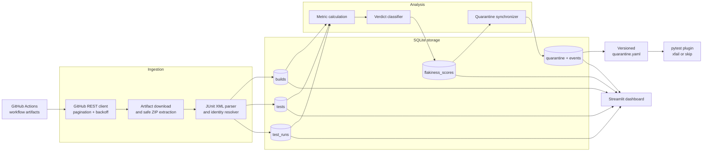

# ChilliFlake

ChilliFlake is a CI flaky-test detection and quarantine pipeline. It collects
JUnit XML reports from GitHub Actions, preserves test history in SQLite,
classifies tests from their behavior over time, and generates a quarantine file
that pytest can consume without allowing known flakes to fail CI.

The project distinguishes intermittent failures from consistently broken tests
using pass/fail transitions, a 95% Wilson score lower bound, isolated failures,
same-commit conflicts, pass rate, and duration variation.

## Features

- GitHub REST API ingestion with pagination, rate-limit handling, and
  exponential backoff for transient network and server failures.
- Transactional, idempotent ingestion with workflow-run deduplication and
  rollback on failure.
- Project- and branch-scoped analysis over an indexed relational schema.
- Stable, flaky, broken, and insufficient-data verdicts.
- Automatic and manual quarantine management with release and regression
  tracking.
- Atomic, versioned `quarantine.yaml` exports and a pytest consumer plugin.
- Streamlit dashboard for verdicts, history, duration trends, and quarantine
  controls.
- Scheduled GitHub Actions pipeline and database preservation.

## Architecture



### Processing flow

1. The ingestion client lists completed workflow runs and matching artifacts.
2. Previously ingested GitHub run IDs are skipped before artifact API calls.
3. Every matching artifact for a run is downloaded and safely extracted. If an
   artifact download fails, the run is not partially ingested.
4. JUnit testcases are normalized into pytest-compatible identities and written
   to `builds`, `tests`, and `test_runs` in one transaction.
5. The analyzer reads ordered test histories for one project and branch scope,
   calculates metrics, and stores the latest score for every test.
6. Quarantine synchronization adds current flakes, releases sufficiently stable
   automatic entries, and records tests that regress after a release.
7. The YAML export is consumed by the target repository's pytest plugin. Known
   flaky tests still run but are marked `xfail(strict=False)` by default.

### Data model

| Table | Purpose |
| --- | --- |
| `builds` | GitHub run, commit, branch, repository, and creation time |
| `tests` | Project-scoped normalized test identity |
| `test_runs` | Status, duration, retry metadata, and build/test relationships |
| `flakiness_scores` | Latest metrics and verdict for each test and branch scope |
| `analysis_runs` | Configuration and timestamp for each scoring snapshot |
| `verdict_history` | Significant verdicts associated with analysis snapshots |
| `quarantine` | Active and released automatic or manual quarantine records |
| `quarantine_events` | Quarantined, released, and regressed transitions |

Indexes cover test history lookup, build/test joins, branch and commit queries,
and normalized test identity uniqueness.

## Repository layout

```text
ChilliFlake/
├── config/projects.yaml             # Source repository and workflow settings
├── dashboard/app.py                 # Streamlit dashboard
├── db/schema.sql                     # SQLite schema and indexes
├── docs/ci-integration.md            # Target-repository pytest setup
├── docs/validation_dask.md           # Real Dask CI validation record
├── scripts/run_pipeline.py           # End-to-end pipeline command
├── scripts/migrate_v2.py             # Test identity/schema migration
├── scripts/migrate_v3.py             # Project isolation/history migration
├── src/ingestion/                     # GitHub client and JUnit ingestion
├── src/analyzer/                      # Scoring, quarantine, and pytest plugin
├── tests/                             # Unit and end-to-end tests
└── quarantine.yaml                    # CI-consumable quarantine export
```

## Requirements and setup

Use Python 3.11 or newer.

```sh
python -m venv .venv
# Windows: .venv\Scripts\activate
# Linux/macOS: source .venv/bin/activate
pip install -r requirements-dev.txt
```

Copy `.env.example` to `.env` and configure:

```dotenv
GITHUB_TOKEN=your_fine_grained_token
DB_PATH=db/chilliflake.db
```

A fine-grained token with **Actions: read** access is recommended for higher
rate limits and required for private repositories. Public metadata can be read
anonymously, but GitHub may still require authentication when downloading
artifact archives.

Project defaults live in `config/projects.yaml`. Home Assistant and Dask are
included. Dask ingestion selects Linux artifacts from its `Tests` workflow so
repeated observations remain comparable.

### Existing databases

Back up existing databases and run both migrations before analysis:

```sh
python scripts/migrate_v2.py --db db/chilliflake.db
python scripts/migrate_v3.py --db db/chilliflake.db
```

## Running the pipeline

Run all stages with one command:

```sh
python scripts/run_pipeline.py \
  --project home-assistant-core \
  --branch dev \
  --runs 50 \
  --db db/chilliflake.db
```

Or run each stage independently:

```sh
python -m src.ingestion.run_ingestion \
  --project home-assistant-core --runs 50 --branch dev

python -m src.analyzer.run_analysis \
  --project home-assistant-core --branch dev

python -m src.analyzer.quarantine --db db/chilliflake.db sync \
  --project home-assistant-core --branch dev --dry-run

python -m src.analyzer.quarantine --db db/chilliflake.db sync \
  --project home-assistant-core --branch dev

python -m src.analyzer.quarantine --db db/chilliflake.db export \
  --project home-assistant-core --branch dev --out quarantine.yaml
```

The pipeline is safe to rerun. Previously ingested workflow runs are skipped,
analysis replaces only the selected project/branch score scope, and quarantine
synchronization is idempotent.

## Scoring and verdicts

For each non-skipped test history, ChilliFlake calculates:

- **Pass rate:** passing observations divided by total observations.
- **Flip rate:** status changes divided by adjacent observation pairs.
- **Wilson lower bound:** the conservative 95% lower confidence bound for the
  observed flip proportion.
- **Isolated failures:** failures surrounded by passes in the ordered history.
- **Same-commit conflicts:** commits where the same test both passed and failed.
- **Duration coefficient of variation:** sample standard deviation divided by
  mean duration.

Verdict precedence is:

1. Too few observations → `insufficient_data`.
2. Pass rate below the broken threshold → `broken`.
3. At least one same-commit pass/fail conflict → `flaky`.
4. Wilson evidence above the flaky threshold with enough isolated failures →
   `flaky`.
5. Otherwise → `stable`.

Thresholds can be overridden from the analyzer CLI. Project-level minimum
sample defaults are defined in `config/projects.yaml`.

## Quarantine lifecycle

- **Newly quarantined:** currently flaky and never previously auto-quarantined.
- **Released:** previously auto-quarantined and now stable after enough new
  observations.
- **Regressed:** previously released, later flaky again, and re-quarantined.
- **Manual:** added by a user and never released automatically.

Exports use `schema_version: 1`, deterministic test ordering, and an atomic
temporary-file replacement. Compare two exports with:

```sh
python -m src.analyzer.quarantine diff \
  old-quarantine.yaml new-quarantine.yaml --fail-on-regressed
```

## Using the quarantine in CI

Install pytest and PyYAML in the target repository, copy the plugin, and point
it to the generated file:

```yaml
- run: pip install pytest pyyaml
- run: pytest -p chilliflake_plugin
  env:
    CHILLIFLAKE_QUARANTINE_FILE: quarantine.yaml
```

Quarantined tests run as non-strict expected failures by default. To skip them:

```yaml
env:
  CHILLIFLAKE_QUARANTINE_MODE: skip
```

See [the complete CI integration guide](docs/ci-integration.md).

## Dashboard

```sh
streamlit run dashboard/app.py
```

The dashboard provides project and branch filters, verdict counts, flip/Wilson
charts, searchable score tables, per-test execution and duration history, and
manual quarantine controls. Queries use a read-only SQLite connection; manual
actions use short-lived write connections.

## Scheduled operation

`.github/workflows/daily.yml` restores the latest database, runs ingestion,
analysis, quarantine synchronization, and export, then uploads the database and
YAML as workflow artifacts.

Store a fine-grained token as the repository secret
`CHILLIFLAKE_GITHUB_TOKEN`. GitHub's automatic workflow token is scoped to the
repository containing the workflow and cannot authenticate cross-repository
artifact access.

GitHub source artifacts expire, so the SQLite database is the durable history
and should be preserved between scheduled runs.

## Validation

The preserved Dask validation dataset contains 20 real GitHub Actions runs,
6,422,260 testcase observations, and 18,481 scored tests. See
[the Dask validation record](docs/validation_dask.md) for methodology, evidence,
and reproduction commands.

## Development

```sh
python -m pytest -q
python -m compileall -q db src scripts dashboard tests
```

The current suite contains 88 passing tests, including GitHub client behavior,
JUnit parsing, rollback and idempotency, metrics, project/branch isolation,
migrations, quarantine transitions, YAML validation, pytest integration,
dashboard startup, and an end-to-end pipeline test. CI runs on Python 3.11 and
3.12.

## Limitations

- Infrastructure-wide failures can resemble mass flakiness.
- Renamed tests begin a new history unless identities are migrated manually.
- JUnit `<error>` elements are currently stored as `failed`; `timedOut` and
  `interrupted` remain reserved database statuses.
- Artifact availability is limited by the source repository's GitHub retention
  policy.
