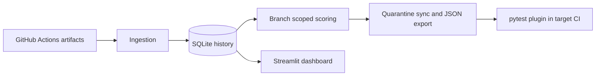

# ChilliFlake

ChilliFlake ingests JUnit XML from GitHub Actions, scores test histories, maintains a quarantine list, and provides a Streamlit dashboard.



## Setup

Use Python 3.11 or newer. Install dependencies with `pip install -r requirements-dev.txt`. Set `GITHUB_TOKEN` and optionally `DB_PATH` in `.env` (the token needs repository Actions read access). Existing databases should be backed up and upgraded with `python scripts/migrate_v2.py --db db/chilliflake.db` before analysis.

## Pipeline

```sh
python -m src.ingestion.run_ingestion --runs 50 --branch dev
python -m src.analyzer.run_analysis --branch dev
python -m src.analyzer.quarantine --db db/chilliflake.db sync --dry-run
python -m src.analyzer.quarantine --db db/chilliflake.db sync
python -m src.analyzer.quarantine --db db/chilliflake.db export --out quarantine.json
streamlit run dashboard/app.py
```

In the target repository, install ChilliFlake and run:

```yaml
- run: python -m src.analyzer.quarantine export --out quarantine.json
- run: CHILLIFLAKE_QUARANTINE_FILE=quarantine.json pytest -p src.analyzer.pytest_plugin
```

Quarantined tests run and are marked `xfail(strict=False)` by default. Set `CHILLIFLAKE_QUARANTINE_MODE=skip` for skip behavior.

## Metrics and verdicts

- Flip rate is status changes divided by adjacent result pairs. Its Wilson lower bound measures the flip proportion, not the failure proportion.
- Isolated failures count a failing result surrounded by passes.
- Commit conflicts count commits with both passing and failing results for a test and are the strongest flakiness signal.
- Verdict precedence is insufficient sample count, nearly always failing (`broken`), same-commit conflict (`flaky`), statistically supported flips with enough isolated failures (`flaky`), then `stable`.
- `timedOut` and `interrupted` are reserved database statuses; the current JUnit parser maps `<error>` to `failed` and does not emit these reserved values.
- The analyzer defaults to branch `dev`; `--branch ''` scores all branches. Branch-specific scoring is important because cross-commit or cross-branch changes can be real regressions.

`python scripts/run_pipeline.py` chains ingestion, scoring, quarantine sync, and JSON export. The daily workflow stores a SQLite backup and publishes the database and quarantine output as workflow artifacts. GitHub Actions source artifacts expire, so preserve the database as the long-term history.

## Limitations

- Class-chain recovery for old database rows works only when the old path came from a classname fallback.
- Infrastructure-wide failures can resemble mass flakiness; builds with unusually high failure rates are not filtered yet.
- Only `home-assistant/core` is configured as the default ingestion project.
- Renamed tests start a new history.
- Duplicate testcase entries within a build remain separate observations. A live artifact inspection is needed to determine whether the target CI emits retry duplicates and whether they should be collapsed.

On the checked-in database, the branch-indexed scoring pass processed 18,481 tests for `main` in about 13 seconds (2026-10-23); wall time depends on the selected branch and host.
