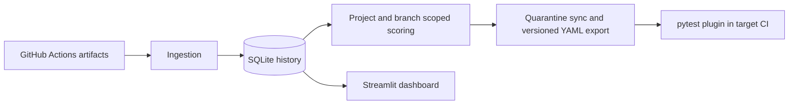

# ChilliFlake

ChilliFlake ingests JUnit XML from GitHub Actions, scores test histories, maintains a project-scoped quarantine list, and provides a Streamlit dashboard.



## Setup

Use Python 3.11 or newer. Install dependencies with `pip install -r requirements-dev.txt`. Copy `.env.example` to `.env`, and optionally set `DB_PATH`. A fine-grained `GITHUB_TOKEN` with **Actions: read** access is recommended for higher rate limits and required for private source repositories; public metadata can be read anonymously, though artifact archives may still require authentication. Back up existing databases and run both migrations before analysis:

```sh
python scripts/migrate_v2.py --db db/chilliflake.db
python scripts/migrate_v3.py --db db/chilliflake.db
```

Project defaults are in `config/projects.yaml`. Both Home Assistant and Dask are configured; Dask ingestion selects Linux artifacts from its `Tests` workflow so repeated runs remain comparable.

See [the Dask validation record](docs/validation_dask.md) for the preserved real-CI dataset and reproduction commands.

For the scheduled workflow, store the same token as the repository secret `CHILLIFLAKE_GITHUB_TOKEN`. GitHub's automatic workflow token is scoped to the repository containing the workflow and cannot authenticate cross-repository artifact access.

## Pipeline

```sh
python -m src.ingestion.run_ingestion --project home-assistant-core --runs 50 --branch dev
python -m src.analyzer.run_analysis --project home-assistant-core --branch dev
python -m src.analyzer.quarantine --db db/chilliflake.db sync --project home-assistant-core --branch dev --dry-run
python -m src.analyzer.quarantine --db db/chilliflake.db sync --project home-assistant-core --branch dev
python -m src.analyzer.quarantine --db db/chilliflake.db export --project home-assistant-core --branch dev --out quarantine.yaml
streamlit run dashboard/app.py
```

The pipeline is safe to rerun: previously ingested workflow runs are skipped, analysis replaces only the selected project/branch score scope, and quarantine sync is idempotent. A run is not ingested when any matching artifact fails to download.

Exports have `schema_version: 1`, stable ID ordering, and an atomic write. The analyzer records each scoring run and writes quarantine transition events, including regressions after a previous release. Compare two exports with:

```sh
python -m src.analyzer.quarantine diff old.yaml new.yaml --fail-on-regressed
```

- **Newly quarantined:** currently flaky and never previously auto-quarantined.
- **Released:** previously auto-quarantined and now stable with enough additional samples.
- **Regressed:** previously released and flagged flaky again, so it is quarantined again.
- Manual quarantine entries are never automatically released.

See [docs/ci-integration.md](docs/ci-integration.md) for using the pytest plugin.

## Metrics and verdicts

- Flip rate is status changes divided by adjacent result pairs. Its Wilson lower bound measures the flip proportion, not the failure proportion.
- Isolated failures and same-commit pass/fail conflicts contribute to flaky verdicts.
- `timedOut` and `interrupted` are reserved database statuses; the JUnit parser currently maps `<error>` to `failed`.
- Infrastructure-wide failures can resemble mass flakiness, and renamed tests start a new history.

GitHub Actions artifacts expire, so preserve the SQLite database as the long-term history.

## Development and verification

```sh
python -m pytest -q
python -m compileall -q db src scripts dashboard
```

CI runs the tests on Python 3.11 and 3.12. The dashboard opens the database read-only for queries and uses short-lived write connections only for manual quarantine actions.
